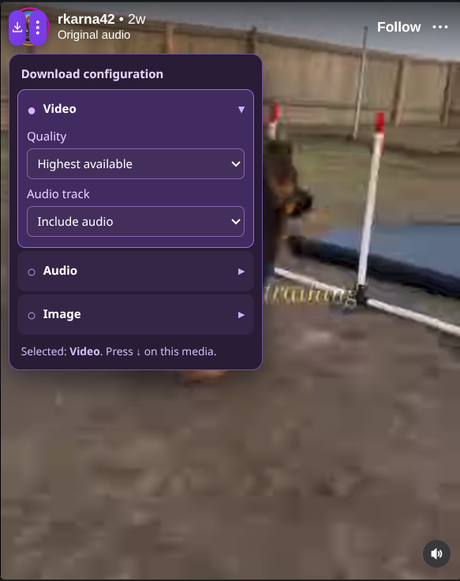
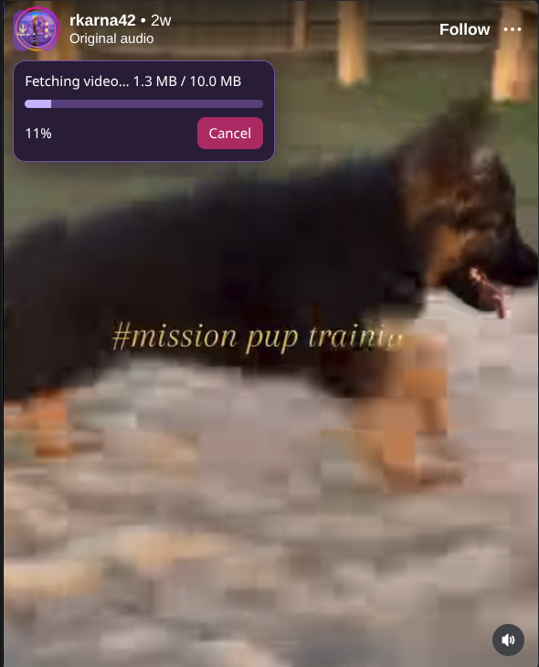

# RemiInstagramDownloader





A Google Chrome Manifest V3 extension for Windows, macOS and Linux. Every **visible Instagram photo, video, or Reel thumbnail** receives its own small violet control pair, positioned in the **top-left corner of that media**. More than one pair can be visible at once, for example on the feed or a profile grid.

## Controls on each media item

| Button | Function |
| --- | --- |
| Violet narrow rectangle **↓** | Download **this media item**, not an arbitrary item elsewhere on the page. |
| Violet **⋮** | Open the configuration submenu for **this media item**. |

Only **two buttons are persistently shown per item**. Each is **18px wide** (half the original 36px) and **36px tall**, with a **3px gap**. The settings icon uses **three vertical dots (⋮)**, now drawn as centered SVG circles; the arrow is centered by the same flex alignment and zero-padding layout. A floating progress bar and **Cancel** button appear for that item while it is downloading; the item manages its own progress/cancel state independently from other media. Scrolling, opening a new Reel, or moving to a carousel slide repositions or creates the relevant control pair.

- For images, **Image** is the default selection. Settings: highest/current resolution, original/JPEG.
- For videos, **Video** is the default selection. Settings: highest/balanced/smaller quality, audio included or disabled.
- Choose **Audio** in ⋮ on a video to download a separate audio stream or extract embedded audio, when available.
- **All choices are per media item:** selecting Video/Audio/Image or changing any quality, sound, source, resolution or format option affects **only that item**. A different image or video retains its own settings and starts from the unchanged defaults.
- Individual settings are restored when the same identifiable media returns after scrolling or an Instagram DOM re-render, and are stored locally using an item identity (post shortcode plus a media-path fingerprint). For blob-only media without a reliably identifiable asset/poster, settings remain isolated to its current player element instead of incorrectly transferring to another carousel slide.
- Existing older shared preferences (`remi_config` / `remi_config_v2`) are deliberately not imported, because that would make one media item's choices become other items' defaults. Up to 200 recent identifiable items can retain their individual settings.

You may start independent downloads on different items, each with its own progress bar and cancellation control.

## Package from source

From the project root (the directory containing `manifest.json` and `pack.sh`), run:

```bash
./pack.sh
```

This generates **`RemiInstagramDownloader.zip` in the same project root directory**. The ZIP places `manifest.json` at its top level and includes only the extension runtime files, icons, and README. It excludes the `tests/` folder, `pack.sh`, caches, and previous generated archives. Running the script again replaces that ZIP. Bash, `zip`, and `unzip` must be installed.

To load the generated ZIP as an unpacked Chrome extension, extract its contents into a folder and select that folder in `chrome://extensions` → **Load unpacked**.

## Installing / updating

1. Unzip `RemiInstagramDownloader.zip` to a folder (the folder must contain `manifest.json`).
2. Open `chrome://extensions` in Chrome and enable **Developer mode**.
3. Click **Load unpacked** and select the extracted `RemiInstagramDownloader` folder. If already installed, replace the unpacked extension's files and click **Reload**.
4. Refresh Instagram. Violet ↓ and ⋮ controls should appear on each large visible media item.
5. Click an item's ↓ to download it, or ⋮ to choose Video, Audio or Image and the corresponding settings.

Chrome saves downloads to the `RemiInstagramDownloader/` subfolder of your default Downloads directory. **100% is displayed only when Chrome reports that the file download completed.** Fetching the media bytes is not treated as a finished download. If Chrome reports an interruption, the progress panel shows the error instead of claiming success.

## Permissions

- `downloads`: save media through Chrome's normal Downloads.
- `storage`: store independent per-item media preferences and temporary observed URLs.
- `offscreen`: process streams and optionally merge video/audio in Chrome.
- `webRequest`: observe media network requests without altering them.
- Host permissions: Instagram and its usual media CDN hosts only.

## Testing (does not require an Instagram login)

```bash
node --check content.js
node --check page-observer.js
node --check background.js
node --check offscreen.js
node tests/observer_test.cjs
node tests/stream_capture_test.cjs
node tests/scoped_media_test.cjs
node tests/carousel_observer_test.cjs
node tests/nested_audio_observer_test.cjs
node tests/observer_bootstrap_test.cjs
node tests/header_playback_test.cjs
node tests/download_completion_test.cjs
node tests/scoped_playback_recovery_test.cjs
node tests/wrapped_bootstrap_test.cjs
python tests/stream_chooser_browser.py
python tests/automatic_quality_browser.py
python tests/browser_unit.py
python tests/post_resolve_browser.py
python tests/video_thumbnail_test.py
python tests/carousel_identity_browser.py
python tests/blob_player_browser.py
```
